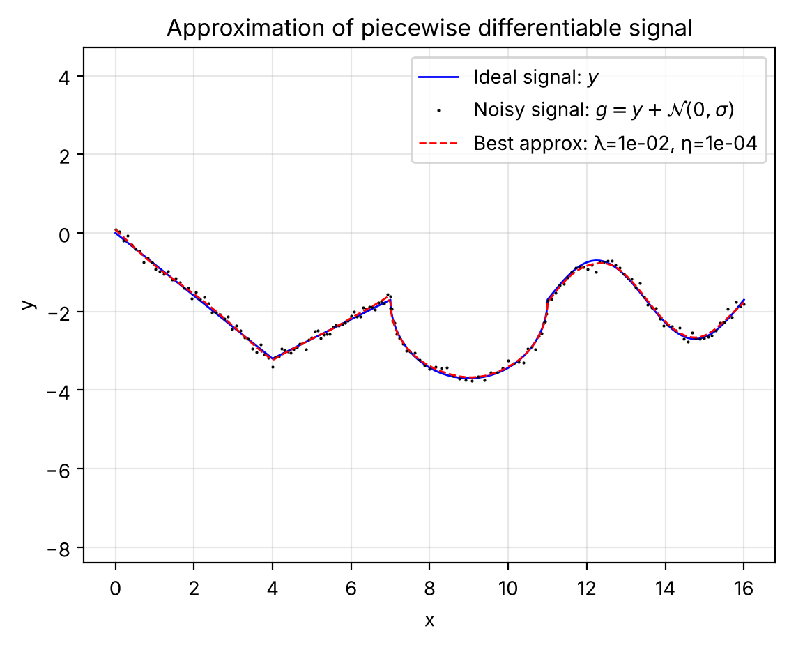
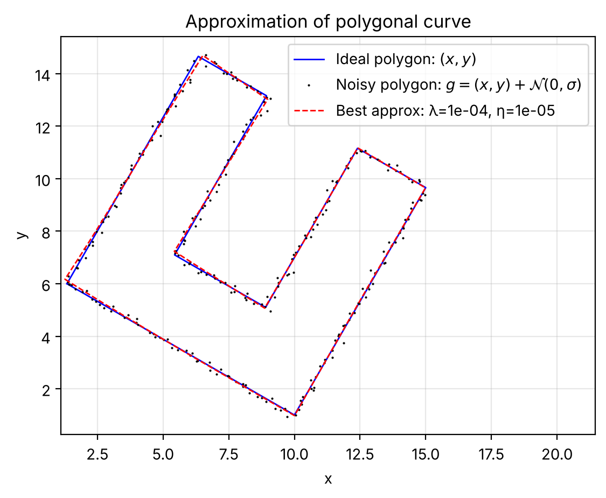
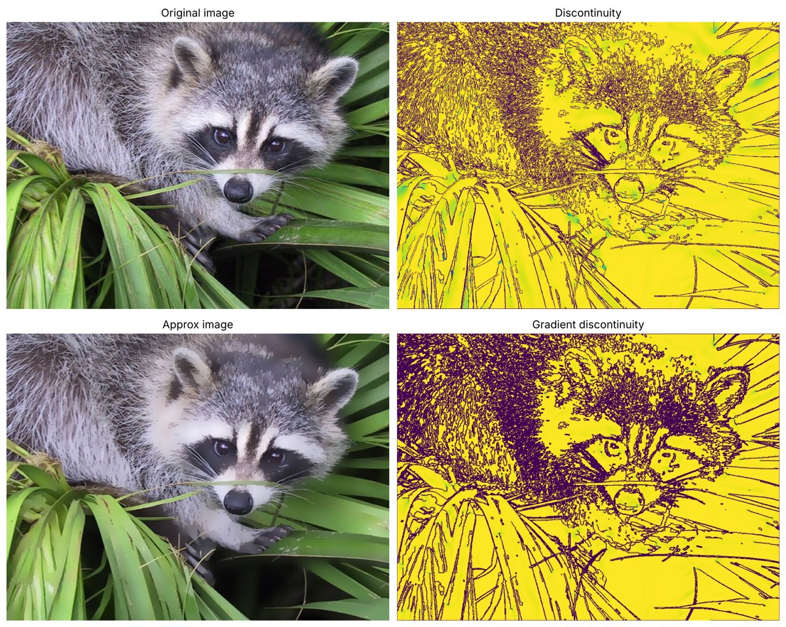

# blakezisserman
[](https://github.com/massimozanetti/blake-zisserman/actions/workflows/tests.yml)

Piecewise-smooth approximation of noisy signals, curves and images with the
Blake–Zisserman variational model [1, 2, 3]. Along with the smoothed data, the model returns
data discontinuities (jumps) and gradient discontinuities (corners or creases), as soft indicator maps.

<p align="center">
  
  
</p>
<p align="center">
  
</p>


## Installation

```bash
git clone https://github.com/massimozanetti/blake-zisserman.git
cd blake-zisserman
pip install .
```

Development mode and examples: 

```bash
pip install -e ".[examples]"
```

Requires Python ≥ 3.10. Dependencies: `numpy`, `scipy`, `pydantic`, `numba`
(plus `matplotlib` and `pooch` for the examples).


## Quick start

```python
import numpy as np
from blakezisserman import BlakeZisserman1D, BlakeZisserman2D

# 1-D: signal of length P, or curve of P points in N dimensions, shape (P,) or (P, N)
x = np.linspace(0, 10, 200)
g = np.abs(x - 5) + 0.1 * np.random.randn(200)
u, z, t, F, converged = BlakeZisserman1D(values=g).solve(llambda=1e-2, eta=1e-4)

# 2-D: grayscale (I, J) or multichannel (I, J, N) image
img = ...                                   # e.g. float array with values in [0, 255]
u, s, z, F, converged = BlakeZisserman2D(values=img).solve(mu=0.01, alpha=2., beta=1., delta=30.)
```

| Output | Meaning |
|---|---|
| `u` | piecewise-smooth approximation of the input |
| `s` | (2-D only) discontinuity indicator: ≈ 1 where `u` is continuous, ≈ 0 on jumps |
| `z` | gradient-discontinuity indicator: ≈ 1 where `u` is smooth, ≈ 0 on corners/creases |
| `t` | (1-D only) curve parametrization (break points) |
| `F` | value of the functional at each outer iteration |
| `converged` | whether the relative change of `F` fell below `fun_rtol` |


## Examples

Run from the repository root; figures are written to `./examples/results/`.

| Script | What it shows | Run time* |
|---|---|---|
| `examples/signal_approximation.py` | noisy piecewise-smooth signal, 6×6 grid of (λ, η) | ~10 s |
| `examples/polygon_approximation.py` | noisy closed polygon (periodic boundary), 6×6 grid of (λ, η) | ~20 s |
| `examples/image_approximation.py` | 768×1024 RGB test image from `scipy.datasets` | ~3 min |

\*On a 2-core machine. The image solver is parallel and runs faster on more cores.


## The model

The Blake-Zisserman model is a free discontinuity minimization problem for the approximation of an input function $g: \Omega \subset \mathbb{R}^2 \to \mathbb{R}$ by a piecewise smooth function $u$ whose discontiunity set $K_0$ and gradient discontinuity set $K_1$ are theirselves unknown variables of the problem. The objective requires to minimize [1]:

$$
\mathcal{BZ}(K_0, K_1, u) = \int_{\Omega \setminus (K_0 \cup K_1)} {|Hu|}^2 + \mu {|u-g|}^2 dx + \alpha \mathcal{H}^1(K_0) + \beta \mathcal{H}^1(K_1)
$$

where $H$ is the Hessian operator, $\mathcal{H}^1$ is the 1-dimensional Hausdorff measure (which measures the length in any n-dimensional space) and $\mu, \alpha, \beta$ are positive parameters penalizing their respective terms.

Numerical minimization is not tractable in this form. Ambrosio, Faina and March [2] proposed a $\Gamma$-convergence approximation of the orginal functional by the family of elliptic funcionals

$$
F_\epsilon(s, z, u) = \delta \int_\Omega z^2 {|Hu|}^2 dx + \xi_\epsilon \int_\Omega (s^2+\omicron_\epsilon) {|\nabla u|}^2 dx + (\alpha - \beta) \mathcal{AT}_\epsilon(s) + \beta \mathcal{AT}_\epsilon(z) + \mu \int_\Omega {|u-g|}^2 dx
$$

where $s, z, u$ are Sobolev functions, $\mathcal{AT}_\epsilon$ is the Ambrosio-Tortorelli component

$$
\mathcal{AT}_\epsilon (v) = \int_\Omega \epsilon {|\nabla v|}^2 + \frac{1}{4 \epsilon} {(v-1)}^2 dx
$$

$\xi_\epsilon, \omicron_\epsilon$ are infinitesimals and $\Gamma$-convergence is intedend for $\epsilon \to 0$. Variables $s, z$ are indicators of discontinuity. Almost everywhere they are identically 1. For large ${|\nabla u|}^2$ values variable $s$ tends to bound the cost of its component by taking value 0, therefore indicating a discontinuity. In the same way, for large  ${|H u|}^2$ values variable $z$ tends to bound the cost of its component, therefore indicating a gradient discontinuity. The Ambrosio-Tortorelli component controls the decay of $s, z$ and approximates the measure of the set where $s, z$ is null.   

In this formulation the objective functional enjoys nice properties for numerical minimization. The `blakezisserman` package implements numerical minimization of functional $F_\epsilon$ for vector valued images and curves [3]. 

### Vector valued images

For an image $g(x,y): \Omega \subset \mathbb{R}^2 \to \mathbb{R}^N$ the `BlakeZisserman2D` class handles the minimization over $s, z, u$ of the functional

$$
\begin{aligned}
F_\epsilon(s, z, u) = {} & \mu\sum|u-g|^2 + \delta\sum z^2 {|H u|}^2 + \xi_\epsilon \sum (s^2+\omicron_\epsilon) {|\nabla u|}^2 \\
& +(\alpha-\beta)\sum\Big(\epsilon|\nabla s|^2+\frac{(s-1)^2}{4\epsilon}\Big)
+\beta\sum\Big(\epsilon|\nabla z|^2+\frac{(z-1)^2}{4\epsilon}\Big)
\end{aligned}
$$

with differential operators:
- ${|\nabla v|}^2 = \sum_{n=1}^N {(\partial_x v_n)}^2 + {(\partial_y v_n)}^2$
- ${|H u|}^2 = \sum_{n=1}^N {(\partial_{xx} u_n)}^2 + {(\partial_{yy} u_n)}^2 + 2 {(\partial_{xy} u_n)}^2$

| Parameter | Role |
|---|---|
| `mu`    | fidelity to the data |
| `delta` | weight of the second-order (Hessian) term |
| `alpha` | cost of discontinuities: `alpha - beta` weights the `s` term |
| `beta`  | cost of gradient discontinuities: `beta` weights the `z` term|
| `epsilon` | width of the transition layers of `s` and `z` (default `1e-2`) |

The value of $\epsilon$-infinitesmials is hardcoded: $\xi_\epsilon = \epsilon^{1/4}$ and $\omicron_\epsilon = \epsilon^2$.

### Vector valued curves

For a curve $g(t): \Omega \subset \mathbb{R} \to \mathbb{R}^N$ the `BlakeZisserman1D` class handles the minimization over $z, u$ of the functional 

$$
F(z, u) =\sum z^2\,|u''|^2 + \lambda\sum|u-g|^2
+\eta \sum \Big(\epsilon |z'|^2 + \frac{(z-1)^2}{4\epsilon}\Big)
$$

with differential operators:
- ${|z'|}^2 = {(\partial_t z)}^2 $
- ${|z''|}^2 = {(\partial_{tt} z)}^2 $

| Parameter | Role |
|---|---|
| `llambda` | fidelity to the data |
| `eta`     | cost of gradient discontinuities: `eta` weights the `z` term |


## Algorithm

The functional is minimized by block-coordinate descent [3]: each outer iteration updates
`s`, `z` and `u` in turn, each by a Jacobi-preconditioned conjugate-gradient step.
Iteration stops when the relative change of `F` is below `fun_rtol` (default `1e-3`)
or after `maxiter` iterations.

Solver options shared by `solve()`: `epsilon`, `fun_rtol`, `maxiter`,
`pcg_maxiter_*` (inner CG iteration limits) and `log_level`
(`'INFO'` prints progress). `BlakeZisserman1D.solve` also takes
`bound_cond` = `'none'`, `'null-neumann'` or `'periodic'` (closed curves).


### Performance

The `u` update in `BlakeZisserman2D` dominates the run time. It solves all channels in one
conjugate-gradient run, stores the stencil matrices by diagonals, and runs the
inner loops in parallel with `numba`. Results do not depend on the number of threads.

- Thread count: `NUMBA_NUM_THREADS=16 python ...`. The kernels are memory-bound,
  so using only physical cores is often as fast as or faster than using hyperthreads.
- The first call compiles the kernels (a few seconds); later runs use the
  on-disk cache.
- Without `numba` the code still runs (pure `numpy` fallback), but much slower.


## Development

The package can be installed in editable mode, so changes under `src/` take effect immediately.

```bash
pip install -e ".[test,examples]"
pytest -q                      # ~1 s
```

```
blake-zisserman/
├── src/blakezisserman/
│   ├── __init__.py            # public API: BlakeZisserman1D, BlakeZisserman2D
│   ├── model.py               # pydantic models: input and parameter validation
│   └── core.py                # solvers (solve1d, solve2d) and numba kernels
├── examples/                  # runnable scripts used for the figures above
├── tests/                     # pytest suite (run by GitHub Actions on every push)
└── docs/images/               # README figures
```


## References

[1] A. Blake and A. Zisserman, *Visual Reconstruction*, MIT Press, 1987.

[2] L. Ambrosio, L. Faina, and R. March, *Variational approximation of a second order free discontinuity problem in computer vision*, SIAM Journal on Mathematical Analysis, 2001.

[3] M. Zanetti, L. Bruzzone, *Piecewise linear approximation of vector-valued images and curves via second-order variational model*, Transactions on Image Processing, 2017.
